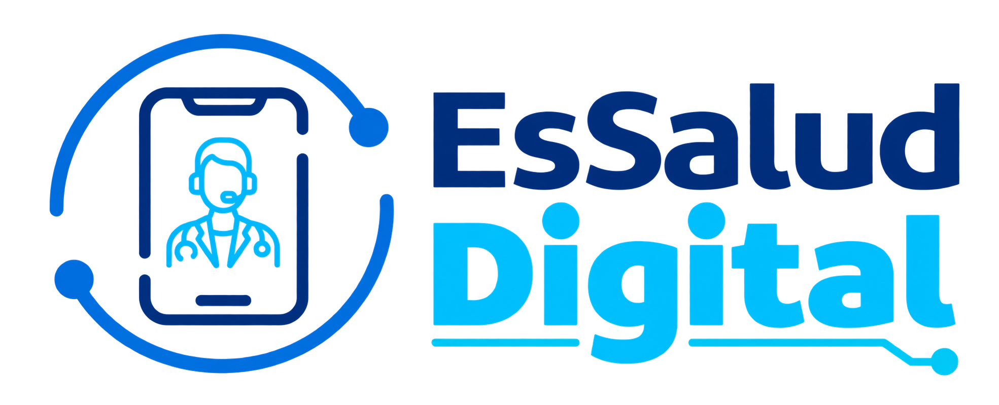
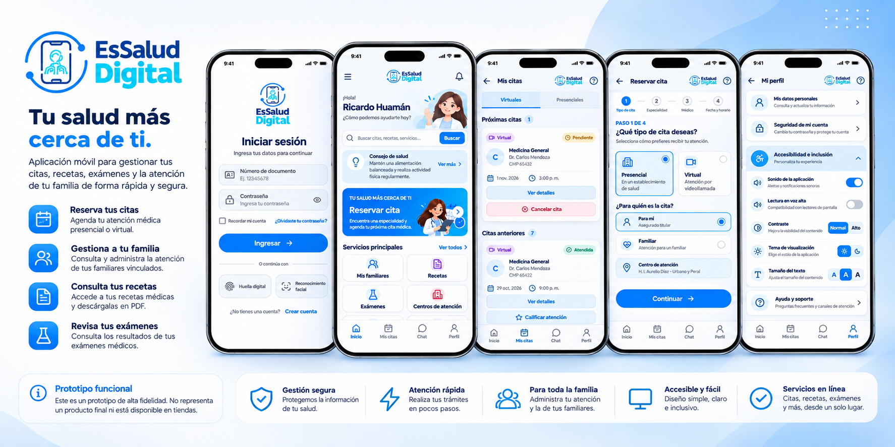

<div align="center">



# 🏥 EsSalud Digital

### Tu salud más cerca de ti.

<p>


</p>

### Prototipo web de alta fidelidad para facilitar el acceso a servicios de salud, gestionar citas médicas y consultar información personal y médica desde una experiencia digital intuitiva.

</div>

---

# 📸 Vista previa

<p align="center">

</p>

---

# 📖 Descripción

**EsSalud Digital** es un prototipo de aplicación web orientado a mejorar la experiencia de los asegurados al momento de acceder y gestionar sus servicios de salud mediante una plataforma digital.

La aplicación busca centralizar diferentes funcionalidades relacionadas con la atención médica, permitiendo a los usuarios gestionar sus citas, consultar recetas médicas, revisar exámenes, administrar sus datos personales y gestionar los perfiles de sus familiares vinculados.

El proyecto está desarrollado con **React y Vite**, utilizando una interfaz moderna, intuitiva y adaptable a dispositivos móviles, priorizando la accesibilidad, la organización de la información y la facilidad de navegación.

> ℹ️ **Nota:** Este proyecto es un prototipo académico de alta fidelidad. No es una aplicación oficial de EsSalud ni está integrado con los sistemas institucionales. Los datos y algunas funcionalidades son simulados con fines demostrativos.

---

# ✨ Funcionalidades

| Módulo | Funcionalidades |
|--------|------------------|
| 🔐 **Autenticación** | Inicio de sesión, registro, recuperación de contraseña, verificación de código y cambio de contraseña. |
| 🏠 **Inicio** | Panel principal con acceso a los servicios y funcionalidades de la aplicación. |
| 📅 **Citas médicas** | Consulta de citas, reserva de citas, selección de especialidad, profesional y horario, y visualización del detalle de cada cita. |
| 👨‍👩‍👧 **Gestión familiar** | Vinculación de familiares, selección de pacientes y administración de cuentas asociadas. |
| 💊 **Recetas médicas** | Consulta de recetas nuevas y anteriores, visualización del detalle e impresión o descarga en PDF. |
| 🧪 **Exámenes médicos** | Consulta de exámenes médicos, organización por periodos y visualización de resultados disponibles. |
| 👤 **Perfil y datos personales** | Consulta y actualización de información personal del asegurado. |
| 🔒 **Seguridad de cuenta** | Gestión de contraseña, opciones de seguridad y funcionalidades de autenticación biométrica. |
| 🔔 **Notificaciones** | Interfaz para consultar notificaciones relacionadas con los servicios de la aplicación. |
| 💬 **Asistencia** | Acceso a funcionalidades de ayuda y soporte al usuario. |

---

# 🖼️ Pantallas principales

- 🏥 **Splash Screen** — presentación e identidad visual de EsSalud Digital.
- 🔑 **Inicio de sesión** — acceso a la aplicación.
- 📝 **Registro de usuario** — creación de una cuenta.
- 🏠 **Inicio** — acceso centralizado a los servicios.
- 📅 **Mis citas** — consulta y seguimiento de citas médicas.
- 🗓️ **Reservar cita** — selección de especialidad, profesional y horario.
- 👨‍👩‍👧 **Familiares vinculados** — selección y gestión de pacientes.
- 💊 **Recetas médicas** — consulta y descarga de recetas.
- 🧪 **Exámenes médicos** — consulta del historial de exámenes.
- 👤 **Perfil** — administración de información personal.
- 🔐 **Seguridad** — opciones para proteger la cuenta.

---

# 🛠 Stack tecnológico

<div align="center">


<br><br>


</div>

### Tecnologías utilizadas

| Tecnología | Aplicación |
|---|---|
| **React** | Desarrollo de interfaces mediante componentes reutilizables. |
| **Vite** | Entorno de desarrollo y compilación. |
| **JavaScript** | Lógica e interactividad de la aplicación. |
| **React Router DOM** | Navegación y gestión de rutas. |
| **CSS3** | Diseño y estilos de la interfaz. |
| **Lucide React** | Iconografía de la aplicación. |
| **html2pdf.js** | Generación y descarga de documentos PDF. |
| **localStorage** | Persistencia local de datos simulados. |
| **pnpm** | Administración de dependencias. |
| **Git y GitHub** | Control de versiones y almacenamiento del código fuente. |

---

# 🏛 Arquitectura

El proyecto utiliza una arquitectura basada en componentes y páginas mediante **React**, organizando la interfaz, la navegación y la lógica de negocio en módulos independientes.

Se utiliza **React Router DOM** para gestionar las rutas y servicios propios para centralizar operaciones relacionadas con usuarios, familiares, citas y recetas médicas.

La estructura permite mantener el código organizado, facilitar el mantenimiento y reutilizar componentes en diferentes pantallas.

```text
📦 src
│
├── assets              # Imágenes, logos y recursos gráficos
│
├── components          # Componentes reutilizables
│   ├── BottomNavigation.jsx
│   ├── ConfirmacionModal.jsx
│   ├── LoadingOverlay.jsx
│   └── ...
│
├── pages               # Pantallas de la aplicación
│   ├── Inicio
│   ├── Autenticación
│   ├── Citas médicas
│   ├── Gestión familiar
│   ├── Recetas médicas
│   ├── Exámenes médicos
│   ├── Perfil
│   └── Seguridad de cuenta
│
├── services            # Lógica y gestión de datos
│   ├── usuariosService.js
│   ├── recetasService.js
│   └── ...
│
├── App.jsx             # Configuración de rutas
├── App.css             # Estilos de la aplicación
├── index.css           # Estilos globales
└── main.jsx            # Punto de entrada
```

---

# 📂 Estructura del proyecto

```text
app-essalud-v2
│
├── docs
│   └── images
│       ├── logo.png
│       └── preview.png
│
├── public
│
├── src
│   ├── assets
│   ├── components
│   ├── pages
│   ├── services
│   ├── App.jsx
│   ├── App.css
│   ├── index.css
│   └── main.jsx
│
├── index.html
├── vite.config.js
├── eslint.config.js
├── package.json
├── pnpm-lock.yaml
└── README.md
```

---

# 🚀 Instalación y ejecución

## 1. Clonar el repositorio

```bash
git clone https://github.com/yxdhii/app-essalud-v2.git
```

## 2. Acceder al proyecto

```bash
cd app-essalud-v2
```

## 3. Instalar dependencias

```bash
pnpm install
```

## 4. Ejecutar en modo desarrollo

```bash
pnpm run dev
```

## 5. Compilar para producción

```bash
pnpm run build
```

## 6. Previsualizar la compilación

```bash
pnpm run preview
```

---

# 🌐 Acceso local

Una vez iniciado el servidor de desarrollo, puedes acceder desde tu navegador:

```text
http://localhost:5173
```

---

# 🚀 Despliegue

El proyecto está preparado para su despliegue mediante **Vercel**, utilizando Vite como herramienta de compilación.

Configuración de despliegue:

| Configuración | Valor |
|---|---|
| Framework Preset | Vite |
| Build Command | `pnpm build` |
| Output Directory | `dist` |
| Install Command | `pnpm install` |

---

# 📌 Estado del proyecto

🚧 **En desarrollo activo.**

El prototipo continúa en proceso de implementación, incorporando mejoras en la experiencia de usuario, navegación, diseño visual y funcionalidades de los diferentes módulos.

---

<div align="center">

## 👩🏻‍💻 Desarrollado por

### **Yadhira Patricia Saavedra Guadalupe**

Estudiante de **Ingeniería de Sistemas**  
Universidad Tecnológica del Perú (UTP)

<br>

[](https://www.linkedin.com/in/itsyxdhi/)
[](https://yadhira-portafolio.vercel.app)
[](https://github.com/yxdhii)

<br>

⭐ **Si este proyecto te resultó interesante, considera darle una estrella al repositorio.**

© 2026 · EsSalud Digital

</div>
